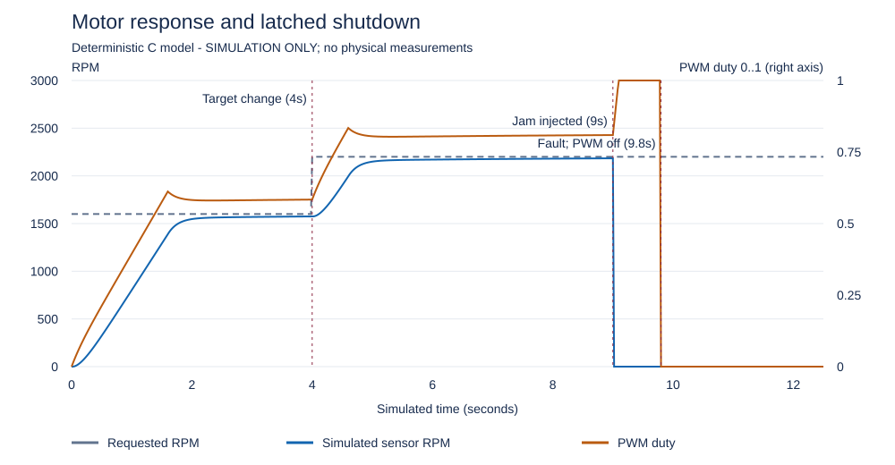
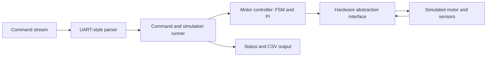

# Embedded Motor Control & Fault Monitoring System

A C11 motor-control application demonstrating **closed-loop speed regulation, deterministic state transitions, motor fault detection and controlled recovery**. The system separates control logic from hardware interfaces and uses a simulated motor to exercise normal operation, disturbances and failure conditions.



The trace shows a commanded speed change, a simulated shaft jam at 9 seconds and the controller latching a stall fault and disabling PWM at 9.8 seconds. [Explore the data](assets/simulation_trace.csv) or [read the demonstration transcript](assets/stall_transcript.txt).

## Engineering highlights

- **Embedded C architecture:** portable C11 modules, caller-owned state, fixed-size input buffers and a callback-based hardware abstraction layer (HAL).
- **Motor speed control:** feedforward plus PI regulation with a setpoint ramp, output slew limits and conditional integral anti-windup.
- **State management:** IDLE, RUNNING, FAULT and RECOVERY states with deliberate startup, direction-change and restart interlocks.
- **Fault monitoring:** overtemperature, overcurrent, bus-voltage limits, overspeed, stale/invalid sensor data, stalled rotation and emergency-stop command handling.
- **Recovery logic:** latched fault history, explicit reset conditions, continuous recovery dwell and a separate START command after reset.
- **UART-style command processing:** bounded byte framing, command validation and recovery after malformed or oversized input.
- **Reproducible validation:** 34 C regression tests, nine end-to-end scenarios and a 626-sample simulated response trace.

## System architecture



The motor-control layer implements state handling, sensor validation, PI output calculation and protection logic without referencing the host simulator. The HAL exposes sensor-read and actuator-write callbacks so the same controller interface can be adapted to embedded targets.

| Module | Responsibility |
|---|---|
| [`motor_controller.c`](src/motor_controller.c) | State machine, speed control, faults and recovery |
| [`motor_hal.c`](src/motor_hal.c) | Interface between the controller and device inputs/outputs |
| [`motor_plant.c`](src/motor_plant.c) | Deterministic motor/sensor simulation and fault injections |
| [`uart_protocol.c`](src/uart_protocol.c) | Bounded serial-style command framing |
| [`console.c`](src/console.c) | Commands, diagnostics and scripted scenarios |
| [`test_motor_controller.c`](tests/test_motor_controller.c) | Automated unit and boundary tests |

For state-transition diagrams, control equations and sensor thresholds, see [Architecture & Control Design](docs/ARCHITECTURE.md).

## Build and run on Windows

**Requirements:** Windows PowerShell and GCC with C11 support. The supplied PowerShell script uses `gcc` from your PATH, or MSYS2 UCRT64 at `C:\msys64\ucrt64\bin\gcc.exe`. No external C libraries are required.

Open the extracted repository root in VS Code and run:

```powershell
powershell -NoProfile -ExecutionPolicy Bypass -File .\scripts\build.ps1
powershell -NoProfile -ExecutionPolicy Bypass -File .\scripts\test.ps1
```

Run the demonstration scenarios:

```powershell
.\build\motor_sim.exe --script .\examples\normal_operation.txt
.\build\motor_sim.exe --script .\examples\stall.txt
.\build\motor_sim.exe --script .\examples\estop_recovery.txt
```

Or start the interactive console with `.\build\motor_sim.exe` and enter commands:

```text
SPEED 1600
START
STEP 4000
STATUS
ESTOP
STEP 1200
ESTOP RELEASE
RESET
STEP 1000
START
STEP 1200
STOP
STATUS
```

`STEP` advances simulated time (not wall-clock time) in multiples of 20 ms. Type `HELP` for the supported command syntax.

A CMake/CTest build is also included for other desktop toolchains:

```sh
cmake -S . -B build -DCMAKE_BUILD_TYPE=Release
cmake --build build
ctest --test-dir build --output-on-failure
```

## Verification results

The test suite checks the control logic, input handling, sensor validity, fault latching, reset interlocks and software-output inhibition across normal and fault scenarios.

| Verification | Recorded result |
|---|---|
| C regression tests | **34/34 passed** |
| Scripted integration scenarios | **9/9 passed** |
| Simulated response trace | **626 rows** at 20 ms intervals |
| Fault response in trace | Stall latched at **9.8 s** with PWM set to zero |

The repository includes the [test plan](docs/TEST_PLAN.md), [verification results](docs/TEST_RESULTS.md) and [captured Windows test output](assets/verification_windows.txt). The plotted values are generated by the C motor model and are not physical measurements.

## Design choices

**Separation of concerns.** The controller operates on inputs and outputs rather than directly on host I/O or MCU registers, keeping the control policy testable independently of the simulation.

**Predictable command and fault behaviour.** Input frames have a fixed upper bound, invalid commands are rejected, and fault conditions require explicit recovery rather than automatically restarting the motor.

**Controlled output changes.** Feedforward and PI feedback regulate the modeled speed while setpoint ramps, slew limits and anti-windup constrain command changes.

## Engineering scope

This is a **software simulation** with an interface intended for future hardware integration. It does not implement an STM32 peripheral driver, physical emergency-stop circuit or hardware-validated motor protection. The modeled stop command disables simulated output and allows coasting. See [Safety & Hardware Integration Scope](docs/SAFETY_SCOPE.md) for the requirements of adapting the design to real equipment.

Licensed under the [MIT License](LICENSE).
