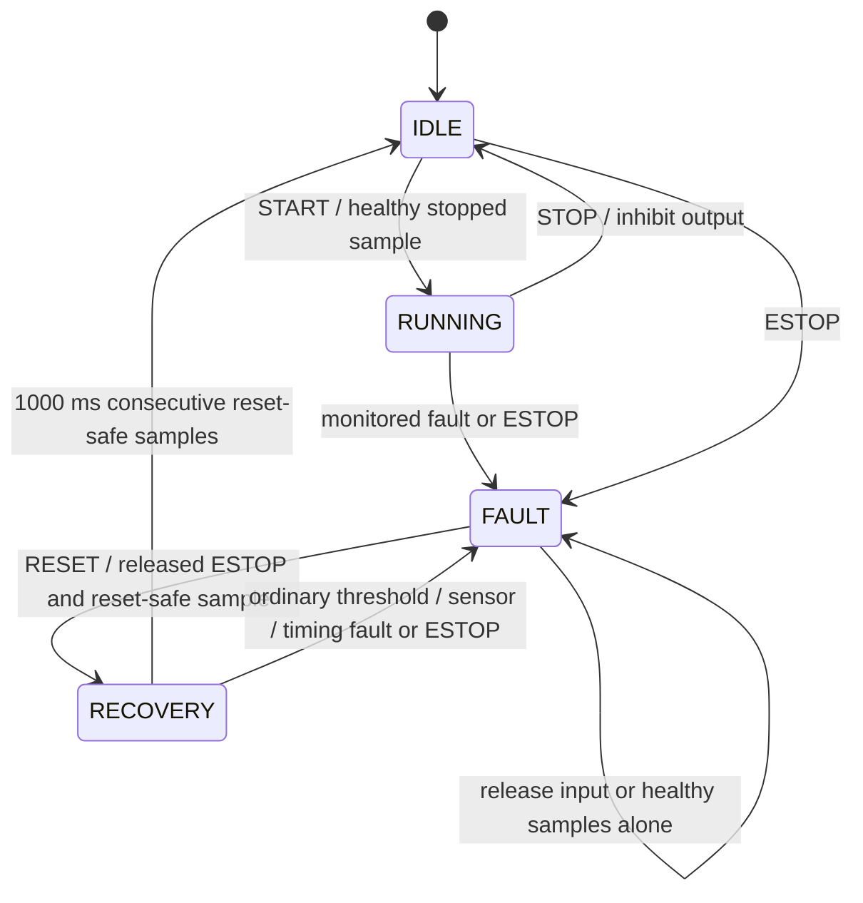

# Architecture and control design

## Execution and ownership

The controller and UART parser use caller-owned structs and fixed buffers; they do not allocate memory, perform OS I/O or invoke the host plant. All controller pointers are required to be non-null and initialized. Calls are single-owner, not thread-safe. `motor_tick` accepts a null sample and treats it as failed acquisition during active control. `motor_hal_cycle` separately rejects a null controller or incomplete callback contract.

The host app owns a controller, plant, HAL callbacks and last applied output. Commands change controller policy or model injections. A step applies controller output, advances plant by 20 ms, reads through HAL and invokes the controller. Initialization acquires one disabled sample and increments the controller's uptime by 20 ms; trace timestamps count simulation steps from zero instead. Direction is an output flag, and speed is a magnitude. The plant deliberately does not model physical signed rotor reversal.

A board HAL must acquire a coherent sample with valid engineering-unit scaling, measured acquisition age and peripheral status; write enable/PWM/direction with correct sequencing and hardware defaults; and call the loop with measured elapsed time. The interface cannot verify that an actuator physically accepted its write. An invalid HAL contract inhibits the in-memory controller and writes off only if a write callback exists. Independent hardware inhibition remains necessary.

## State transitions and invariants

- Output enable is true only in RUNNING, after a valid tick. All other states have duty zero and enable false. START changes state but leaves output off until the next healthy control update.
- STOP sets IDLE and clears integral/ramp/stall timer immediately; physical speed is not assumed to stop instantaneously.
- START and DIR require a previously acquired healthy sample and speed <=50 RPM; a missing or invalid-timing acquisition removes startup eligibility.
- ESTOP asserts a held input and enters FAULT immediately. `ESTOP RELEASE` changes only that input. It never resets/restarts.
- RESET is allowed only in FAULT with released ESTOP, valid ordinary limits, temperature <=70 C, current <=1 A and speed <=50 RPM.
- RESET clears the active fault mask on entry to RECOVERY. A lifetime OR diagnostic `fault_history` remains available. These have distinct meanings; a zero active mask in RECOVERY does not mean permission to run.
- Recovery requires a continuous 1000 ms of reset-safe samples. A sample between reset thresholds and trip thresholds resets the dwell to zero while remaining RECOVERY. A trip/sensor/timing fault returns to FAULT. Completion returns to IDLE, never RUNNING.
- Additional sensor/threshold faults observed in FAULT are accumulated in active/history masks. Commands cannot bypass the latch. Corrupted/out-of-range state enum is detected on tick and inhibited as INTERNAL, which does not claim general memory-corruption tolerance.

## Sensor acceptance and thresholds

These values illustrate policy, not physical rated limits.

| Signal/check | Rule |
|---|---|
| Validity | Missing, `valid=false`, nonfinite, or acquisition age >40 ms gives SENSOR |
| Plausible ranges | Temperature -40..150 C; current 0..100 A; magnitude speed 0..10000 RPM; bus 0..60 V |
| Thermal trip | Temperature >=80 C |
| Current trip | Current >=9 A |
| Bus trip | Bus <18 V or >30 V; endpoints accepted |
| Overspeed trip | Magnitude speed >=3300 RPM |
| Reset conditions | All ordinary checks pass, temperature <=70 C, current <=1 A, speed <=50 RPM, ESTOP released |
| Timing | 1..40 ms accepted; 0 or >40 ms faults RUNNING/RECOVERY and invalidates cached sample in every state |

Numerical validity takes precedence over threshold classification: a NaN is SENSOR, not a thermal/current trip. Multiple ordinary limits can be returned as an OR mask. IDLE is output-disabled; unsafe readings block START but do not automatically latch a fault until active control. Missing execution cannot be detected by software that does not run; this is why a real watchdog and hardware power-stage inhibit are separate requirements.

## Control algorithm and anti-windup

For elapsed time `dt` seconds:

1. Ramp `r` toward requested speed by at most `1000 * dt` RPM.
2. Normalize error `e = (r - measured_speed) / 3000`.
3. Form proposed integral `Inew = clamp(I + 0.35*e*dt, -0.4, 0.4)`.
4. Form unsaturated demand `u = r/3000 + 0.65*e + Inew`.
5. Find the reachable duty interval `[max(0, duty-2*dt), min(1, duty+2*dt)]`.
6. Accept the integral when demand lies in that interval, or when error drives an outlying demand back toward it. Otherwise retain the previous integral.
7. Recompute demand using accepted integral, clamp to 0..1 and slew actual duty by at most `2*dt`. Set output direction and enable.
8. Check continuous stall qualification; fault entry overrides duty/enable to off in this update.

Feedforward assumes 3000 RPM at full duty before load. It is intentionally imperfect so feedback has a purpose. The PI gain values and integral bound are illustrative. Amplitude/rate limiting and anti-windup reduce demanding integrator accumulation, but do not establish closed-loop stability for an unknown real plant. The 60 s unreachable-load test checks bounded state, then a lower setpoint checks recovery; it is not a control-performance benchmark.

## Stall detector

Qualify a stall when ramped target >=200 RPM, drive effort >=`max(0.08, 0.5*ramped_rpm/3000)` and measured speed <15% of ramped target for 800 consecutive ms. Any nonqualifying sample clears elapsed stall time. This avoids classifying initial low speed at zero effort as a stall and covers low as well as high requested speeds. Tests check normal startup followed by a jam at 200, 500, 1800 and 2800 RPM; independent review also checked 27 targets. Thresholds must be reworked using real low-speed sensor resolution and current/torque behaviour before hardware use.

## Host plant and injections

`target = 3000*duty*(1-0.5*load)`; speed approaches target with `alpha=dt/(0.25+dt)` (backward-Euler first-order lag). Jam sets magnitude speed to zero. Current when driven is `0.5 + 1.2*duty + 3*load + abs(target-speed)/3000` A; jam substitutes `6+duty` A, deliberately below the overcurrent trip so the separate stall detector is exercised. Disabled output draws zero modeled current. Temperature uses `dT/dt = 0.04*I^2 - 0.06*(T-25)` C/s. Default bus is 24 V, ambient 25 C, load 0.2.

`INJECT` can override measured temperature/current/speed/bus/age, alter load, disconnect sensor or jam shaft. Overrides do not alter the controller's limits. CLEAR restores injection flags/default load but does not artificially reset physical-model speed/temperature. Sensor bias/freeze, quantization, winding dynamics, signed speed, actual PWM, friction, inertia identification and noise are not represented.

## Protocol

`uart_feed` accepts at most 127 ASCII bytes plus a terminating NUL. CR or LF completes a nonempty frame; CRLF does not create an extra command. Overflow, NUL, non-ASCII and disallowed controls discard the entire frame through the next delimiter and return an invalid-frame event (`UART_LINE_OVERFLOW`, a shared event name for both oversized and non-ASCII frames). Stream input is byte-based so embedded NUL cannot hide a suffix. EOF completes a pending frame.

The dispatcher parses exact token counts and finite numbers, validates ranges before mutation and limits STEP to positive 20-ms multiples up to 120000 ms. Comments beginning with `#` are ignored. No network service or authentication is implemented: the host console is local demonstration tooling, not a remotely exposed industrial protocol. `strtok` is confined to the single-owner host command layer.

## STM32 adaptation work

Portable: controller structs/logic, numerical policy, command framer and HAL contract. Host-only: plant, FILE/stdin console, CSV tool and test harness. Missing: MCU startup/linker and board project, peripheral HAL, calibrated ADC, encoder capture, PWM/deadtime, actual UART transport/ring buffer, scheduling/ISR concurrency, watchdog and independent ESTOP, electrical power-stage verification. A host build is not an MCU firmware validation.
